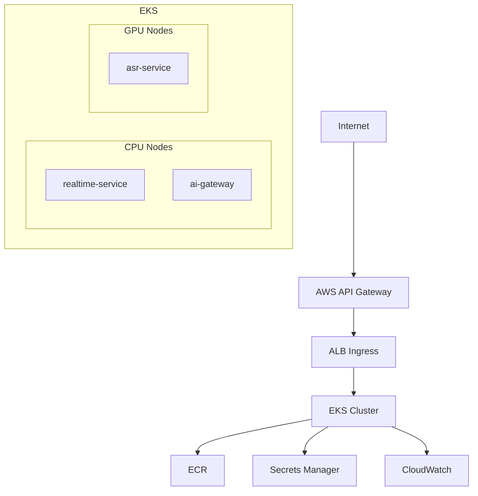

# AWS Deployment

## Overview

This document describes the planned AWS production deployment for Voragon. Introduced in Phase 6 (EKS) with GPU inference in Phase 7.

**Status:** **Phase 6 complete** (signed off **2026-10-16**) — [P6-001](../../infra/ecr/README.md)–[P6-008](../roadmap/dev-step-p6-008-aws-dev-docs-exit.md). **Phase 7 GPU path implemented** (P7-001–P7-007) — follow [Phase 7 end-to-end (GPU)](phase7-gpu-path.md); [Phase 7 exit](../roadmap/dev-step-phase7-exit.md) for operator sign-off.

## Contributor path (Phase 6 end-to-end)

From a clean clone with AWS credentials, kubectl, Docker, and Terraform installed. Order matters for first-time staging.

| Step | Dev-step | Action | Doc |
|------|----------|--------|-----|
| 1 | P6-001 | Create ECR repo; build and push `realtime-backend` image | [infra/ecr/README.md](../../infra/ecr/README.md) |
| 2 | P6-002 | Apply EKS cluster (CPU node group); configure kubeconfig | [infra/eks/README.md](../../infra/eks/README.md) |
| 3 | P6-003 | Set ECR image in Kustomize; `kubectl apply -k k8s/eks`; verify `/health` | [k8s/eks/README.md](../../k8s/eks/README.md) |
| 4 | P6-004 | ALB Ingress + WebSocket stickiness; `curl` ALB `/health` | [k8s/eks/alb/README.md](../../k8s/eks/alb/README.md) |
| 5 | P6-005 | API Gateway token mint; enable JWT on backend | [infra/apigateway/README.md](../../infra/apigateway/README.md), [jwt-auth.example.yaml](../../k8s/eks/jwt-auth.example.yaml) |
| 6 | P6-006 | CloudWatch log group + Fluent Bit; verify Logs Insights | [k8s/eks/logging/README.md](../../k8s/eks/logging/README.md) |
| 7 | P6-007 | ACM + Route 53 alias; Ingress host + cert ARN | [infra/dns/README.md](../../infra/dns/README.md), [k8s/eks/dns/README.md](../../k8s/eks/dns/README.md) |
| 8 | — | **Desktop E2E:** production URL + auth → Connect → transcription | [desktop/README.md](../../desktop/README.md#production-aws-staging), [realtime-websocket.md](../api/realtime-websocket.md#authentication-production) |

**Smoke checks before desktop:**

```bash
curl -f "https://<api-host>/health"
dig +short <api-host>
```

**JWT (staging):**

```bash
cd infra/apigateway
TOKEN_URL="$(terraform output -raw auth_token_url)"
MINT_KEY="$(terraform output -raw mint_api_key)"
curl -sS -X POST "$TOKEN_URL" -H "x-api-key: $MINT_KEY" -d '{}' | jq -r .access_token
```

WebSocket URL: `wss://<api-host>/v1/realtime` (custom host after P6-007, or ALB hostname during bring-up). Token URL stays on API Gateway execute-api unless you extend custom domains.

## Architecture



## Deployment Phases

| Phase | Components | Infrastructure |
|-------|-----------|---------------|
| Phase 6 | realtime-service on EKS | EKS cluster, CPU nodes, ALB, API Gateway |
| Phase 7 | asr-service on GPU nodes; remote ASR from realtime | GPU node pool (g5.xlarge) — [phase7-gpu-path.md](phase7-gpu-path.md) |
| Phase 8 | ai-gateway | Additional CPU deployment |

## Prerequisites

| Resource | Purpose |
|----------|---------|
| AWS Account | Infrastructure hosting |
| EKS Cluster | Container orchestration |
| ECR Repositories | Container image storage |
| VPC with subnets | Network isolation |
| ALB | WebSocket ingress |
| API Gateway | External API entry, auth |
| Secrets Manager | JWT keys, credentials |
| Route 53 (optional) | DNS for `api.voragon.example` |

## ECR (P6-001)

Create the `voragon/realtime-backend` repository and push images before deploying to EKS.

| Step | Doc |
|------|-----|
| Terraform apply | [infra/ecr/README.md](../../infra/ecr/README.md) |
| Build + push | Same doc — uses `docker/realtime-backend/Dockerfile` from repo root |

Image URI and tags (git SHA, optional `latest`) are consumed by EKS manifests in P6-003.

## EKS (P6-002)

Staging CPU cluster for Phase 6 (default name `voragon-staging`, region `ap-northeast-1`).

| Step | Doc |
|------|-----|
| Terraform apply | [infra/eks/README.md](../../infra/eks/README.md) |
| kubeconfig | `aws eks update-kubeconfig` (see outputs) |
| Verify | `kubectl get nodes` — Ready; optional ECR pull smoke pod |

Workers can pull from the P6-001 ECR repo via `AmazonEC2ContainerRegistryReadOnly` on the managed node role.

## Realtime on EKS (P6-003)

Apply Kubernetes manifests after the cluster and ECR image exist.

| Step | Doc |
|------|-----|
| Set ECR image (Kustomize) | [k8s/eks/README.md](../../k8s/eks/README.md) |
| Apply + health | `kubectl apply -k k8s/eks`, port-forward `/health` |

## ALB Ingress (P6-004)

Internet-facing ALB with sticky sessions for WebSocket (controller installed by [infra/eks](../../infra/eks/README.md) Terraform).

| Step | Doc |
|------|-----|
| Load Balancer Controller | `terraform -chdir=infra/eks apply` |
| Ingress + ACM | [k8s/eks/alb/README.md](../../k8s/eks/alb/README.md) |
| Verify | `curl -f https://<alb-host>/health`, `wss://<alb-host>/v1/realtime` |

## API Gateway auth (P6-005)

JWT minting for staging WebSocket clients; WSS remains on the ALB ingress.

| Step | Doc |
|------|-----|
| Terraform (HTTP API + Lambda token) | [infra/apigateway/README.md](../../infra/apigateway/README.md) |
| Enable backend validation | [k8s/eks/jwt-auth.example.yaml](../../k8s/eks/jwt-auth.example.yaml) |
| Desktop settings | Auth token URL + mint API key; backend URL = ALB `wss://…/v1/realtime` |

Token flow and wire format: [realtime-websocket.md](../api/realtime-websocket.md#authentication-production).

## CloudWatch logging (P6-006)

Pod stdout from `realtime-backend` (JSON via `LOG_FORMAT=json`) → **Fluent Bit DaemonSet** → log group **`/voragon/eks/realtime-backend`**.

| Step | Doc |
|------|-----|
| Terraform (log group + Fluent Bit Helm) | [infra/eks/README.md](../../infra/eks/README.md) |
| Verify + Logs Insights | [k8s/eks/logging/README.md](../../k8s/eks/logging/README.md) |

## DNS and TLS (P6-007)

Stable hostname and ACM on the ALB Ingress (WSS path). JWT auth remains on API Gateway execute-api unless you add a custom domain later.

| Step | Doc |
|------|-----|
| ACM + Route 53 alias | [infra/dns/README.md](../../infra/dns/README.md) |
| Ingress host + cert ARN | [k8s/eks/dns/README.md](../../k8s/eks/dns/README.md) |
| Verify | `dig`, `curl -f https://<api-host>/health`, desktop `wss://<api-host>/v1/realtime` |

Default documented hostname: **`api.voragon.example`** (override `api_fqdn` in Terraform).

## Later deployment phases

Phase 6 step-by-step detail is in [Contributor path (Phase 6 end-to-end)](#contributor-path-phase-6-end-to-end) above. Probes and HPA are defined in [k8s/eks](../../k8s/eks/README.md) manifests (P6-003/P6-004).

### Phase 7: GPU Inference (implemented)

Full contributor path: **[Phase 7 end-to-end (GPU)](phase7-gpu-path.md)**.

| Step | Status | Dev-step | Doc |
|------|--------|----------|-----|
| 1 | Implemented | P7-001 | [GPU node group](../../infra/eks/README.md#gpu-node-pool-p7-001) |
| 2 | Implemented | P7-002 | [NVIDIA device plugin](../../infra/eks/README.md#nvidia-device-plugin-p7-002) · [k8s/eks/gpu](../../k8s/eks/gpu/README.md) |
| 3 | Implemented | P7-003 | [ASR image + ECR](../../docker/asr-inference/README.md) |
| 4 | Implemented | P7-004 | [asr-service on GPU](../../k8s/eks/gpu/README.md) |
| 5 | Implemented | P7-005 | [Model PVC](../../k8s/eks/README.md#model-weight-pvcs-p7-005) |
| 6 | Implemented | P7-006 | [Remote ASR](../../k8s/eks/README.md) (`ASR_BACKEND=remote`) |
| 7 | Implemented | P7-007 | [GPU + inference metrics](../../k8s/eks/gpu/README.md#gpu-metrics-p7-007) · [observability.md](observability.md) |
| 8 | Operator | — | Latency: scrape `voragon_asr_inference_duration_seconds`; record p50/p95 in [Phase 7 exit](../roadmap/dev-step-phase7-exit.md) |

### Phase 8: AI Gateway

1. Deploy ai-gateway service
2. Configure model registry (ConfigMap)
3. Update realtime-service to route through ai-gateway
4. Register asr-service in model registry
5. Validate capability alias resolution

## Container Images

| Image | Base | Size (estimated) |
|-------|------|-----------------|
| `voragon/realtime-backend` | python:3.11-slim | ~200 MB |
| `voragon/asr-inference` | nvidia/cuda:12.x-runtime | ~4 GB (includes model) |
| `voragon/ai-gateway` | python:3.11-slim | ~150 MB |

## Configuration Management

| Config | Storage | Phase |
|--------|---------|-------|
| Service settings | ConfigMap | Phase 6 |
| Model registry | ConfigMap | Phase 8 |
| JWT keys | Secrets Manager | Phase 6 |
| Model weights | EBS PVC (`voragon-model-cache` CPU, `voragon-asr-model-cache` GPU; 10Gi `gp2`, `/var/lib/voragon/model-cache`) | Phase 7 |

## DNS and TLS

| Component | Configuration |
|-----------|--------------|
| API endpoint | `api.voragon.example` (Route 53 alias → ALB) — [infra/dns](../../infra/dns/README.md) |
| TLS certificate | ACM (DNS validation) on ALB listener — Ingress `certificate-arn` |
| WebSocket URL | `wss://api.voragon.example/v1/realtime` |
| Auth token URL | API Gateway HTTP API (P6-005), not the API hostname unless extended |

## Rollback Strategy

| Scenario | Action |
|----------|--------|
| Bad deployment | `kubectl rollout undo deployment/<name>` |
| Model loading failure | Readiness probe prevents traffic to unhealthy pods |
| GPU node failure | HPA provisions new GPU node; client reconnects |
| TLS / DNS issue | Repoint or remove Route 53 alias; revert Ingress cert/host; use ALB DNS until fixed ([infra/dns](../../infra/dns/README.md)) |

## Cost Monitoring

- Set up AWS Cost Explorer tags on EKS resources
- Monitor GPU node utilization; scale down during low-traffic periods
- Review monthly: EC2, EKS, ALB, API Gateway, data transfer costs
- See [AWS GPU Strategy](../architecture/aws.md) for cost planning methodology

## Related Documents

- [infra/ecr/README.md](../../infra/ecr/README.md) — ECR Terraform and push workflow
- [infra/eks/README.md](../../infra/eks/README.md) — EKS staging cluster + Load Balancer Controller
- [k8s/eks/alb/README.md](../../k8s/eks/alb/README.md) — ALB Ingress
- [AWS GPU Strategy](../architecture/aws.md)
- [Kubernetes Architecture](../architecture/kubernetes.md)
- [Observability](observability.md)
- [Phase 7 GPU path](phase7-gpu-path.md)
- [Local Kubernetes](kubernetes-local.md)
