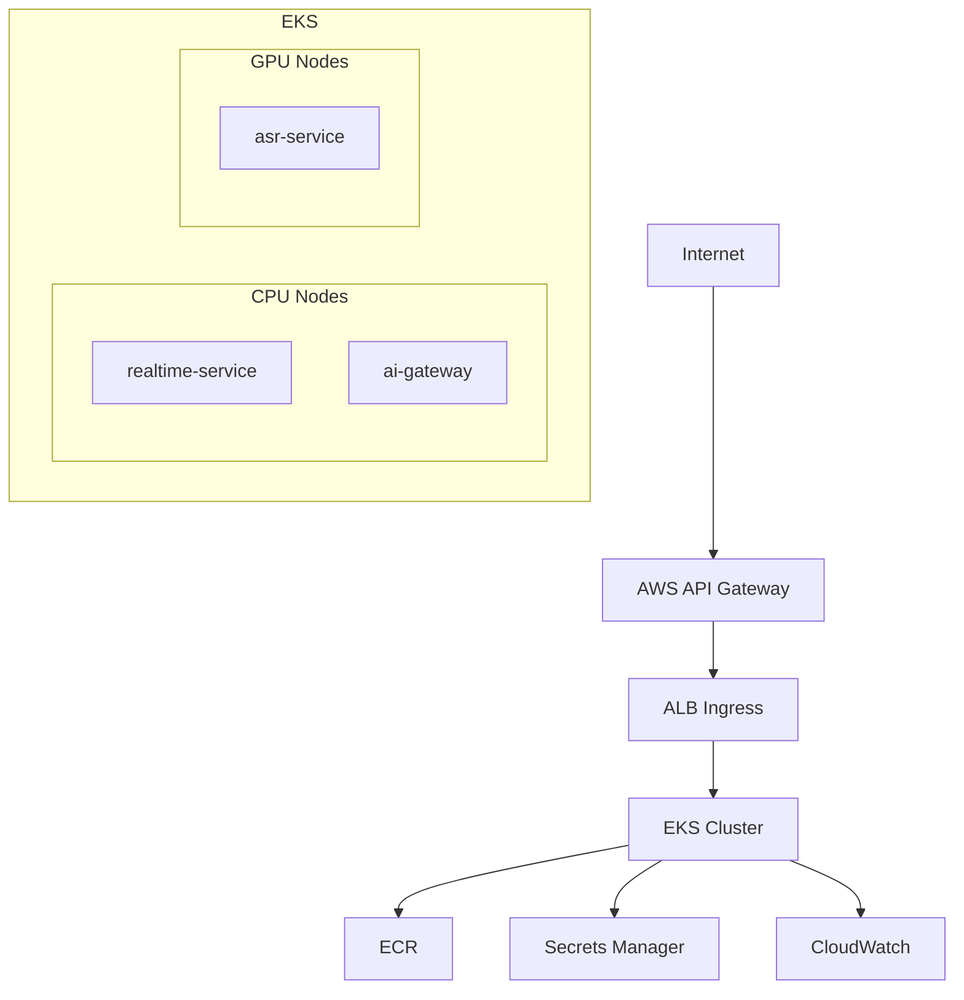

# AWS Deployment

## Overview

This document describes the planned AWS production deployment for Voragon. Introduced in Phase 6 (EKS) with GPU inference in Phase 7.

**Status:** Partial — [P6-001 ECR](../../infra/ecr/README.md)–[P6-004 ALB](../../k8s/eks/alb/README.md) done; [P6-005 API Gateway auth](../../infra/apigateway/README.md) in progress; CloudWatch/DNS (P6-006+) planned.

## Architecture

## Deployment Phases

| Phase | Components | Infrastructure |
|-------|-----------|---------------|
| Phase 6 | realtime-service on EKS | EKS cluster, CPU nodes, ALB, API Gateway |
| Phase 7 | asr-service on GPU nodes | GPU node pool (g5.xlarge) |
| Phase 8 | ai-gateway | Additional CPU deployment |

## Prerequisites

| Resource | Purpose |
|----------|---------|
| AWS Account | Infrastructure hosting |
| EKS Cluster | Container orchestration |
| ECR Repositories | Container image storage |
| VPC with subnets | Network isolation |
| ALB | WebSocket ingress |
| API Gateway | External API entry, auth |
| Secrets Manager | JWT keys, credentials |
| Route 53 (optional) | DNS for `api.voragon.example` |

## ECR (P6-001)

Create the `voragon/realtime-backend` repository and push images before deploying to EKS.

| Step | Doc |
|------|-----|
| Terraform apply | [infra/ecr/README.md](../../infra/ecr/README.md) |
| Build + push | Same doc — uses `docker/realtime-backend/Dockerfile` from repo root |

Image URI and tags (git SHA, optional `latest`) are consumed by EKS manifests in P6-003.

## EKS (P6-002)

Staging CPU cluster for Phase 6 (default name `voragon-staging`, region `ap-northeast-1`).

| Step | Doc |
|------|-----|
| Terraform apply | [infra/eks/README.md](../../infra/eks/README.md) |
| kubeconfig | `aws eks update-kubeconfig` (see outputs) |
| Verify | `kubectl get nodes` — Ready; optional ECR pull smoke pod |

Workers can pull from the P6-001 ECR repo via `AmazonEC2ContainerRegistryReadOnly` on the managed node role.

## Realtime on EKS (P6-003)

Apply Kubernetes manifests after the cluster and ECR image exist.

| Step | Doc |
|------|-----|
| Set ECR image (Kustomize) | [k8s/eks/README.md](../../k8s/eks/README.md) |
| Apply + health | `kubectl apply -k k8s/eks`, port-forward `/health` |

## ALB Ingress (P6-004)

Internet-facing ALB with sticky sessions for WebSocket (controller installed by [infra/eks](../../infra/eks/README.md) Terraform).

| Step | Doc |
|------|-----|
| Load Balancer Controller | `terraform -chdir=infra/eks apply` |
| Ingress + ACM | [k8s/eks/alb/README.md](../../k8s/eks/alb/README.md) |
| Verify | `curl -f https://<alb-host>/health`, `wss://<alb-host>/v1/realtime` |

## API Gateway auth (P6-005)

JWT minting for staging WebSocket clients; WSS remains on the ALB ingress.

| Step | Doc |
|------|-----|
| Terraform (HTTP API + Lambda token) | [infra/apigateway/README.md](../../infra/apigateway/README.md) |
| Enable backend validation | [k8s/eks/jwt-auth.example.yaml](../../k8s/eks/jwt-auth.example.yaml) |
| Desktop settings | Auth token URL + mint API key; backend URL = ALB `wss://…/v1/realtime` |

Token flow and wire format: [realtime-websocket.md](../api/realtime-websocket.md#authentication-production).

## Deployment Steps (Planned)

### Phase 6: EKS + Realtime Service

1. Create ECR repository and push `realtime-backend` image — **[P6-001 done](../../infra/ecr/README.md)**
2. Create EKS cluster with CPU node group — **[P6-002 Terraform](../../infra/eks/README.md)** (`m6i.large` default)
3. Deploy realtime-service from ECR — **[P6-003 k8s/eks](../../k8s/eks/README.md)** (CPU inference initially)
4. Configure ALB Ingress — **[P6-004 k8s/eks/alb](../../k8s/eks/alb/README.md)**
5. Set up API Gateway JWT auth — **[P6-005 infra/apigateway](../../infra/apigateway/README.md)**
6. Configure health probes and HPA
7. Set up CloudWatch logging
8. Validate WebSocket connectivity from desktop

### Phase 7: GPU Inference

1. Create GPU node group (g5.xlarge)
2. Install NVIDIA device plugin
3. Build and push ASR container image
4. Deploy asr-service with GPU resource requests
5. Configure model weight loading (init container or volume)
6. Update realtime-service to call asr-service
7. Validate inference latency and GPU utilization

### Phase 8: AI Gateway

1. Deploy ai-gateway service
2. Configure model registry (ConfigMap)
3. Update realtime-service to route through ai-gateway
4. Register asr-service in model registry
5. Validate capability alias resolution

## Container Images

| Image | Base | Size (estimated) |
|-------|------|-----------------|
| `voragon/realtime-backend` | python:3.11-slim | ~200 MB |
| `voragon/asr-inference` | nvidia/cuda:12.x-runtime | ~4 GB (includes model) |
| `voragon/ai-gateway` | python:3.11-slim | ~150 MB |

## Configuration Management

| Config | Storage | Phase |
|--------|---------|-------|
| Service settings | ConfigMap | Phase 6 |
| Model registry | ConfigMap | Phase 8 |
| JWT keys | Secrets Manager | Phase 6 |
| Model weights | EBS volume or init container download | Phase 7 |

## DNS and TLS

| Component | Configuration |
|-----------|--------------|
| API endpoint | `api.voragon.example` (Route 53) |
| TLS certificate | ACM certificate on ALB |
| WebSocket URL | `wss://api.voragon.example/v1/realtime` |

## Rollback Strategy

| Scenario | Action |
|----------|--------|
| Bad deployment | `kubectl rollout undo deployment/<name>` |
| Model loading failure | Readiness probe prevents traffic to unhealthy pods |
| GPU node failure | HPA provisions new GPU node; client reconnects |

## Cost Monitoring

- Set up AWS Cost Explorer tags on EKS resources
- Monitor GPU node utilization; scale down during low-traffic periods
- Review monthly: EC2, EKS, ALB, API Gateway, data transfer costs
- See [AWS GPU Strategy](../architecture/aws.md) for cost planning methodology

## Related Documents

- [infra/ecr/README.md](../../infra/ecr/README.md) — ECR Terraform and push workflow
- [infra/eks/README.md](../../infra/eks/README.md) — EKS staging cluster + Load Balancer Controller
- [k8s/eks/alb/README.md](../../k8s/eks/alb/README.md) — ALB Ingress
- [AWS GPU Strategy](../architecture/aws.md)
- [Kubernetes Architecture](../architecture/kubernetes.md)
- [Observability](observability.md)
- [Local Kubernetes](kubernetes-local.md)
