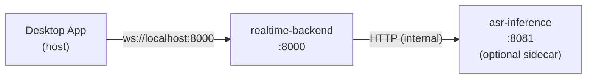

# Docker Compose

## Overview

Docker Compose provides a multi-container local development and testing environment for Voragon. It is introduced in Phase 4, after the single-process local prototype is validated.

**Status:** In progress — [P4-001](../roadmap/dev-step-p4-001-backend-dockerfile.md) Dockerfile and [P4-002](../roadmap/dev-step-p4-002-docker-compose.md) `docker compose up` are implemented. Model cache volumes (P4-003) and Phase 4 exit docs (P4-004) follow.

## Architecture



The desktop application runs on the host (not containerized) for native audio capture and OS integration. The backend and optional ASR sidecar run in containers.

## Planned Services

| Service | Image | Port | GPU | Description |
|---------|-------|------|-----|-------------|
| `realtime-backend` | `voragon/realtime-backend` | 8000 | No | FastAPI WebSocket service |
| `asr-inference` | `voragon/asr-inference` | 8081 | Optional | ASR inference sidecar (if separated) |

### When to Use ASR Sidecar

| Scenario | ASR Location |
|----------|-------------|
| faster-whisper, in-process | Inside `realtime-backend` container |
| whisper.cpp binary | Separate `asr-inference` container |
| GPU inference (NVIDIA) | Separate `asr-inference` container with GPU access |

## Planned Compose File Structure

```
docker/
├── docker-compose.yml          # Main compose file
├── docker-compose.gpu.yml      # GPU override (NVIDIA)
├── realtime-backend/
│   └── Dockerfile
└── asr-inference/
    └── Dockerfile
```

## Realtime backend image (P4-001)

Build and run from the **repository root** (see [docker/realtime-backend/README.md](../../docker/realtime-backend/README.md)):

```bash
docker build -f docker/realtime-backend/Dockerfile -t voragon/realtime-backend:local .
docker run --rm -p 8000:8000 -e ASR_MODEL=tiny voragon/realtime-backend:local
curl -f http://localhost:8000/health
```

Model weights download on **first container start**, not during `docker build`.

## Usage

From the `docker/` directory (repository root is the image build context):

```bash
cd docker
docker compose up --build
```

Stop any host backend or other container already using port **8000** first. First startup may take **1–2 minutes** until the compose healthcheck passes (model download + ASR warmup).

```bash
curl -f http://localhost:8000/health
```

### Planned later

```bash
# Start with ASR sidecar (not implemented)
docker compose up

# Start with GPU support (not implemented)
docker compose -f docker-compose.yml -f docker-compose.gpu.yml up
```

## Volume Mounts

| Mount | Purpose |
|-------|---------|
| Model weights cache | Avoid re-downloading models on container restart |
| Configuration | Override default settings |

## Networking

- `realtime-backend` exposed on `localhost:8000`
- `asr-inference` accessible only within the Docker network (not exposed to host)
- Desktop connects to `ws://localhost:8000/v1/realtime`

## Health Checks

| Service | Check |
|---------|-------|
| `realtime-backend` | `curl -f http://localhost:8000/health` |
| `asr-inference` | `curl -f http://localhost:8081/health` |

## Related Documents

- [Local Development](local-development.md)
- [Kubernetes Local](kubernetes-local.md)
- [Backend Architecture](../architecture/backend.md)
