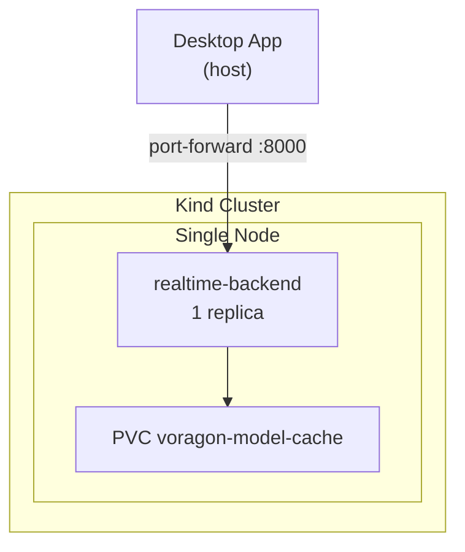

# Local Kubernetes (Kind)

## Overview

A local Kind (Kubernetes in Docker) cluster validates container images, deployment manifests, health probes, and service discovery before deploying to AWS EKS. Introduced in Phase 5.

**Status:** **Implemented** (CPU, single `realtime-backend` Deployment, in-process ASR) — [P5-001](../roadmap/dev-step-p5-001-kind-cluster.md)–[P5-005](../roadmap/dev-step-p5-005-k8s-dev-docs-exit.md). Quick start: [k8s/README.md](../../k8s/README.md).

## Purpose

Kind is used to validate:

- Container images build and run correctly
- Kubernetes manifests (Deployments, Services, ConfigMaps, PVCs)
- Health probes (liveness, readiness, startup)
- Port forwarding for desktop connectivity

Kind is **not** used for performance testing or GPU inference validation.

## Architecture (Phase 5 MVP)

Single pod — same topology as Docker Compose (ASR in-process). A separate `asr-service` appears in production/EKS when the sidecar split exists (Phase 7+).



## Prerequisites

| Tool | Purpose |
|------|---------|
| Docker | Kind node runtime |
| Kind | Local Kubernetes cluster |
| kubectl | Cluster management |

## Setup

From the **repository root** (see [k8s/README.md](../../k8s/README.md)):

```bash
kind create cluster --name voragon --config k8s/kind/voragon.yaml

docker build -f docker/realtime-backend/Dockerfile -t voragon/realtime-backend:local .
kind load docker-image voragon/realtime-backend:local --name voragon

kubectl apply -f k8s/local/namespace.yaml
kubectl apply -f k8s/local/

kubectl wait -n voragon --for=condition=ready pod -l app=realtime-backend --timeout=300s

kubectl port-forward -n voragon svc/realtime-service 8000:8000
```

## Manifests

```
k8s/
├── kind/
│   └── voragon.yaml
└── local/
    ├── namespace.yaml
    ├── configmap.yaml
    ├── pvc.yaml
    ├── realtime-deployment.yaml
    └── realtime-service.yaml
```

Production manifests under `k8s/production/` are Phase 6+.

## Differences from Production EKS

| Aspect | Kind (Local) | EKS (Production) |
|--------|-------------|-----------------|
| Nodes | 1 (no GPU) | CPU + GPU node pools |
| Ingress | port-forward | ALB + API Gateway |
| Auth | None | JWT via API Gateway |
| Scaling | Fixed 1 replica | HPA |
| Storage | local-path PVC | EBS |
| Observability | kubectl logs | Prometheus + Grafana |

## Related Documents

- [k8s/README.md](../../k8s/README.md) — commands and rollout notes
- [Docker Compose](docker.md)
- [Kubernetes Architecture](../architecture/kubernetes.md)
- [AWS Deployment](aws-deployment.md)
