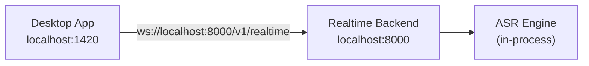
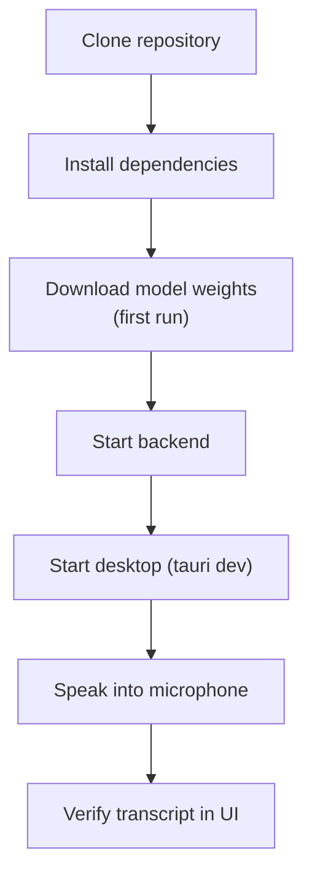

# Local Development

## Overview

Local development for Voragon: **desktop on the host**, **backend** either in Docker (recommended for reproducibility) or a Python venv. No cloud dependencies.

**Status:** Implemented — Phase 3 desktop ([Phase 3 exit](../roadmap/dev-step-phase3-exit.md)); Phase 4 Docker backend ([docker/README.md](../../docker/README.md), [Phase 4 exit](../roadmap/dev-step-phase4-exit.md)); Phase 5 Kind ([k8s/README.md](../../k8s/README.md), [Phase 5 exit](../roadmap/dev-step-phase5-exit.md)). **Phase 6 AWS EKS staging:** [aws-deployment.md](aws-deployment.md) (full contributor path); desktop production connect: [desktop/README.md](../../desktop/README.md#production-aws-staging).

## Prerequisites

| Tool | Version | Purpose |
|------|---------|---------|
| Docker + Compose | Latest | Phase 4 backend (optional if using venv backend) |
| Kind + kubectl | Latest | Phase 5 Kubernetes validation (optional) |
| Python | 3.11+ | Bare-metal backend and pytest |
| Node.js | 20+ | Frontend tooling |
| Rust | 1.77+ | Tauri native layer |
| pnpm or npm | Latest | JavaScript package management |
| Git | Latest | Version control |

### Platform-Specific

| Platform | Additional Requirements |
|----------|----------------------|
| macOS (Apple Silicon) | Xcode Command Line Tools; whisper.cpp recommended for ASR |
| macOS (Intel) | Xcode Command Line Tools |
| Windows | Visual Studio Build Tools; WebView2 runtime |
| Linux (future) | `libwebkit2gtk-4.1-dev`, `libappindicator3-dev` |

### ASR Backend Dependencies

| Backend | Platform | Requirements |
|---------|----------|-------------|
| faster-whisper | NVIDIA GPU or CPU | CUDA toolkit (for GPU); `pip install faster-whisper` |
| whisper.cpp | Apple Silicon or CPU | whisper.cpp binary or `pywhispercpp`; GGUF model file |

## Development Architecture



## Project Structure

```
voragon/
├── desktop/                # Tauri + React application
│   ├── src/                # React frontend
│   └── src-tauri/          # Rust native layer
├── backend/                # FastAPI realtime service
│   ├── app/
│   └── tests/
├── tools/
│   └── realtime-cli/       # Phase 1 CLI test client (mic → transcript)
├── docs/                   # This documentation
├── docker/                 # Docker Compose (Phase 4)
└── k8s/                    # Kubernetes manifests (Phase 5+)
```

## Starting Services

### Recommended: Docker backend + desktop (Phase 4)

Two terminals — no local backend venv required for day-to-day desktop E2E:

```bash
# Terminal 1
cd docker && docker compose up --build

# Terminal 2
cd desktop && pnpm install && pnpm tauri dev
```

Quick reference: [docker/README.md](../../docker/README.md). WebSocket URL: `ws://localhost:8000/v1/realtime`.

Stop anything else on port **8000** before starting compose.

### Optional: Kind backend + desktop (Phase 5)

Use when validating Kubernetes manifests, probes, or rollouts — not required for day-to-day app work.

```bash
# Terminal 1 — see k8s/README.md for first-time cluster + image load
kubectl port-forward -n voragon svc/realtime-service 8000:8000

# Terminal 2
cd desktop && pnpm tauri dev
```

Quick reference: [k8s/README.md](../../k8s/README.md). Same WebSocket URL: `ws://localhost:8000/v1/realtime`.

### AWS EKS staging (Phase 6)

Use when validating the production-like path (ALB, JWT, TLS, CloudWatch) — not for day-to-day app development.

1. Follow [aws-deployment.md](aws-deployment.md) contributor path (ECR → EKS → ALB → API Gateway → DNS).
2. Configure the desktop for `wss://<api-host>/v1/realtime` plus auth — [desktop/README.md](../../desktop/README.md#production-aws-staging).
3. Complete [Phase 6 exit](../roadmap/dev-step-phase6-exit.md) checklist when signing off staging.

Requires AWS account credentials, Terraform, and kubectl. No port-forward; traffic uses the public ALB hostname or custom API DNS.

### Compose vs Kind vs EKS

| | Docker Compose | Kind (Phase 5) | AWS EKS (Phase 6) |
|--|----------------|----------------|-------------------|
| **When** | Default local backend | K8s manifest / probe validation | Staging / production CPU path |
| **Backend URL** | `ws://localhost:8000/v1/realtime` | Port-forward → same localhost URL | `wss://<api-host>/v1/realtime` |
| **Auth** | None | None | JWT via API Gateway ([P6-005](../../infra/apigateway/README.md)) |
| **Manifests** | [docker/](../../docker/) | [k8s/local/](../../k8s/local/) | [k8s/eks/](../../k8s/eks/) |
| **Image** | Local build | `kind load` | [ECR push](../../infra/ecr/README.md) |
| **Guide** | [docker/README.md](../../docker/README.md) | [k8s/README.md](../../k8s/README.md) | [aws-deployment.md](aws-deployment.md) |

Kind vs EKS manifest differences: [kubernetes-local.md](kubernetes-local.md#kind-vs-eks-manifests).

### Alternative: bare-metal backend

Use when changing backend code or running `pytest` against a local interpreter:

```bash
cd backend
python -m venv .venv
source .venv/bin/activate  # Windows: .venv\Scripts\activate
pip install -e ".[dev]"
python -m app.main
# Backend available at http://localhost:8000
```

Then start desktop as above. See [backend/README.md](../../backend/README.md).

### Metrics (Prometheus)

While the backend is running, scrape Prometheus text exposition:

```bash
curl -s http://localhost:8000/metrics | head
```

See [Observability](observability.md) for metric names and Phase 2 scope.

### Desktop

```bash
cd desktop
pnpm install
pnpm tauri dev
# Desktop app launches with hot-reload
```

## Environment Variables (Backend)

Copy [`backend/.env.example`](../../backend/.env.example) to `backend/.env` for persistent local config. Shell env vars override `.env`.

| Variable | Default | Description |
|----------|---------|-------------|
| `HOST` | `0.0.0.0` | Bind address |
| `PORT` | `8000` | Bind port |
| `ASR_BACKEND` | `faster_whisper` | ASR adapter (`faster_whisper`, `whisper_cpp`) |
| `ASR_MODEL` | `large-v3-turbo` | Model identifier |
| `ASR_PARTIAL_INTERVAL_MS` | `300` | Minimum interval between partial transcript inferences |
| `RECONNECT_WINDOW_S` | `30` | Advertised in `session.started` (resume in P2-006) |
| `HEARTBEAT_IDLE_TIMEOUT_S` | `45` | Close idle WebSocket if no inbound messages (P2-001) |
| `LOG_LEVEL` | `debug` | Log level for development |
| `LOG_FORMAT` | `console` | `console` for readable logs; `json` for one JSON object per line (P2-009) |

## Model Download

On first run, the ASR backend downloads model weights:

| Model | Size (approximate) | Location |
|-------|-------------------|----------|
| Whisper Large-v3 Turbo | ~1.5 GB | Hugging Face cache or configured path |
| Silero VAD | ~2 MB | Downloaded automatically |

Model download is a one-time operation per machine (or per Docker volume — see [Docker Compose](docker.md)).

Use `ASR_BACKEND=mock` for fast local runs and automated tests without downloading Whisper weights.

### Logging

Default local development uses human-readable console logs. For structured JSON (production-style):

```bash
LOG_FORMAT=json python -m app.main
```

Each line includes at minimum `timestamp`, `level`, `service` (`realtime-service`), and `message`. WebSocket lifecycle and client error logs add `session_id`; error logs add `code`. Transcript text is not logged.

### Health Check

`GET /health` returns service status and ASR readiness:

```json
{
  "status": "healthy",
  "service": "voragon-realtime-backend",
  "asr": {
    "ready": true,
    "backend": "faster_whisper",
    "model": "large-v3-turbo"
  }
}
```

When ASR warmup has not completed, `status` is `degraded` and `asr.ready` is `false`.

## Test Client (Phase 1)

Minimal CLI for end-to-end local testing without the Tauri desktop app:

```bash
# Terminal 1 — backend (choose one)
cd backend && source .venv/bin/activate && python -m app.main
# Or Docker: cd docker && docker compose up --build  (see docker/README.md)

# Terminal 2 — test client
cd tools/realtime-cli && source .venv/bin/activate && pip install -e ".[dev]"
python -m realtime_cli --duration 15
```

File replay (no microphone; fast upload + `audio.stop` flush + tail wait):

```bash
python -m realtime_cli --file sample-mono-16khz.wav --tail 90
```

Use a longer `--tail` on CPU ASR with long files, or set `ASR_MODEL=tiny` on the backend for faster local runs.

See [tools/realtime-cli/README.md](../../tools/realtime-cli/README.md).

## Development Workflow



## Testing

| Test Type | Tool | Location |
|-----------|------|----------|
| Backend unit tests | pytest | `backend/tests/` |
| Desktop unit tests | vitest | `desktop/src/__tests__/` |
| Desktop Rust tests | cargo test | `desktop/src-tauri/` |
| Compose + CLI E2E | `realtime_cli` | `tools/realtime-cli/` |
| Desktop + backend E2E | Manual | [Phase 3 exit](../roadmap/dev-step-phase3-exit.md), [Phase 4 exit](../roadmap/dev-step-phase4-exit.md) |

```bash
cd backend && source .venv/bin/activate && pytest -q
cd desktop && pnpm test
```

## Troubleshooting

| Issue | Likely Cause | Resolution |
|-------|-------------|------------|
| Port 8000 in use | Host backend or old container | `docker compose down`; stop `python -m app.main` |
| Backend fails to start (venv) | Missing Python dependencies | `pip install -e ".[dev]"` |
| Compose unhealthy long time | First model download | Wait; use `ASR_MODEL=tiny` in compose |
| Model download fails | Network or disk space | Check internet; ensure ~2 GB free |
| No audio in transcript | Microphone permission denied | Check OS microphone permissions |
| High inference latency | CPU-only inference in Docker | Smaller `ASR_MODEL`; bare-metal GPU path later |
| WebSocket connection refused | Backend not running | Start compose or venv backend before desktop |

## Related Documents

- [AWS Deployment (Phase 6)](aws-deployment.md)
- [Docker Compose Setup](docker.md)
- [Backend Architecture](../architecture/backend.md)
- [Desktop Architecture](../architecture/desktop.md)
- [Model Serving](../architecture/model-serving.md)
